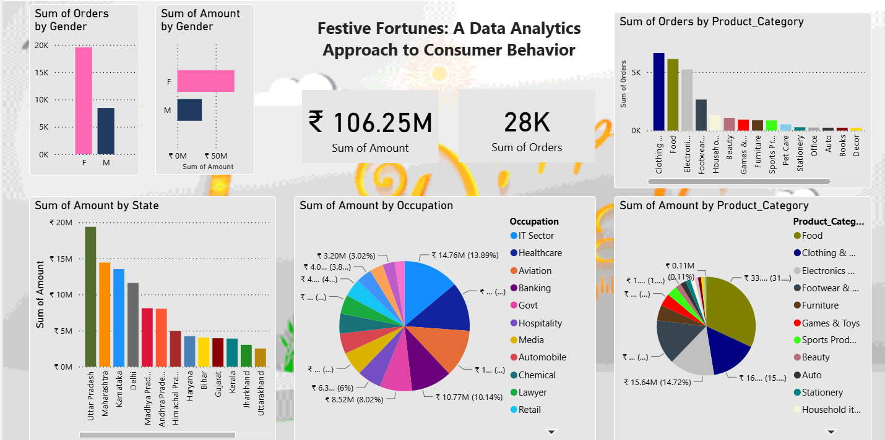

# Festive Fortunes: A Data Analytics Approach to Consumer Behavior

## 🎯 Problem Statement

During the Diwali festive season, retail businesses experience a massive surge in sales volume. However, without a deep understanding of *who* is purchasing and *what* they are buying, businesses risk inventory stockouts, wasted marketing spend, and missed revenue opportunities. 

The objective of this project is to analyze historical Diwali sales data to identify the most valuable customer segments, regional demand variations, and top-performing product categories. By answering these questions, businesses can optimize their supply chain, tailor targeted marketing campaigns, and maximize profitability for future festive seasons.

## 📊 Project Overview

This project provides a comprehensive analysis of customer purchasing behaviors and demographic trends during Diwali. By leveraging a dataset of over 11,000 transactions, we decode consumer patterns to provide actionable insights for inventory management and marketing strategies.

## 🔍 Analysis Methodology (How We Analyzed It)

To solve the business problem, the data was processed and analyzed through the following phases:

1. **Data Ingestion & Setup:** 
   * Created a database schema and imported the raw `.csv` data into PostgreSQL to run basic aggregation queries and validate the dataset's integrity.
2. **Data Cleaning & Preprocessing (Python):** 
   * Handled missing values by dropping empty/unrelated columns (e.g., `Status`, `unnamed1`).
   * Removed null rows to ensure data accuracy, resulting in a clean dataset of 11,239 records.
   * Standardized data types (e.g., converting the `Amount` column to an integer format for precise financial calculations).
3. **Exploratory Data Analysis (EDA):**
   * Leveraged `Pandas` to group and aggregate data based on demographics (Gender, Age, Marital Status, Occupation) and geography (State, Zone).
   * Visualized the purchasing power and order volumes across these groups using `Seaborn` and `Matplotlib` (e.g., bar charts for Sales by State, pie charts for Sales by Occupation).
4. **Dashboarding & Reporting:**
   * Consolidated the key visual findings into a centralized "Diwali Sales Dashboard" to provide stakeholders with a quick, high-level overview of the metrics that matter most.

## 📁 Dataset

The dataset used in this project, `Diwali Sales Data.csv` [kaggle](https://www.kaggle.com/datasets/nazishjaveed/diwale-sale-dataset), contains transaction records and customer details.

* **Original Size:** 11,251 rows and 15 columns.
* **Fields Include:** `User_ID`, `Cust_name`, `Product_ID`, `Gender`, `Age Group`, `Age`, `Marital_Status`, `State`, `Zone`, `Occupation`, `Product_Category`, `Orders`, and `Amount`.

## 🛠️ Tech Stack

* **Database:** PostgreSQL (for data import, schema creation, and SQL querying)
* **Programming Language:** Python 3
* **Libraries:** Pandas, NumPy, Matplotlib, Seaborn
* **Data Visualization:** Matplotlib and Seaborn for Exploratory Data Analysis (EDA), alongside a consolidated Diwali Sales Dashboard.

## 💡 Key Findings

* **Total Performance:** The dataset accounts for 28K total orders generating ₹106.25M in total sales amount.
* **Demographics:** The primary consumer base consists of married women. The 26-35 year age group dominates the purchasing demographic.
* **Purchasing Power:** Female buyers outnumber male buyers and exhibit significantly higher total purchasing power.
* **Regional Insights:** The top three states for both order volume and total sales amount are Uttar Pradesh, Maharashtra, and Karnataka.
* **Occupation:** Customers working in the IT Sector (13.89%), Healthcare, and Aviation sectors are the highest contributors to overall sales.
* **Product Preferences:** The highest-grossing product categories are Food (31.94%), Clothing & Apparel, and Electronics & Gadgets.

## 🚀 How to Run

1. Clone the repository.
2. Ensure you have Python installed along with the required libraries (`pandas`, `numpy`, `matplotlib`, `seaborn`).
3. Run the `Festive_Fortunes_Analysis.ipynb` Jupyter Notebook to view the data cleaning and exploratory data analysis steps.
4. (Optional) Run the queries in `database_Query.db` using PostgreSQL to explore the data using SQL.

## 🖼️ Dashboard Preview

